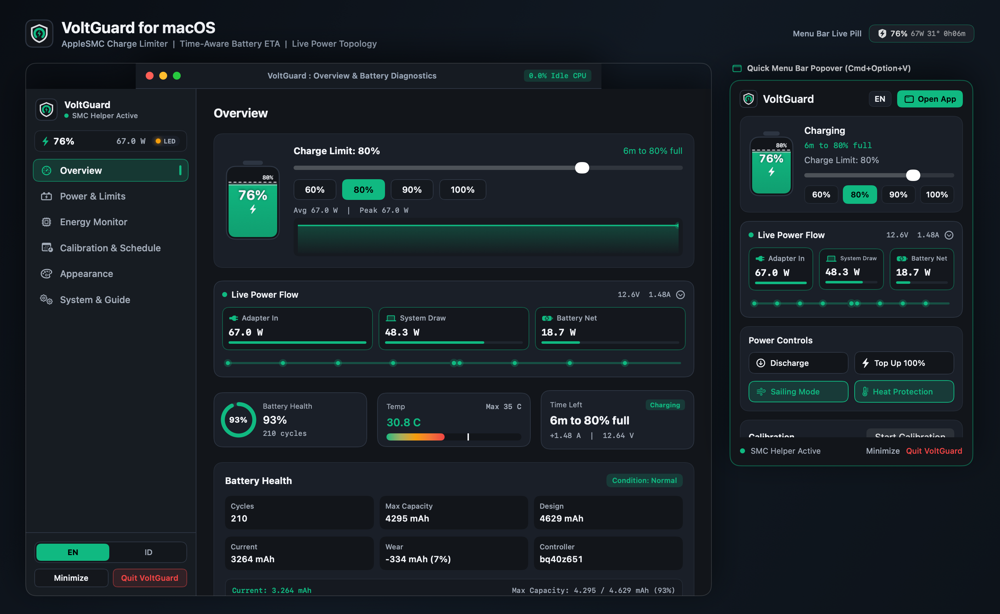
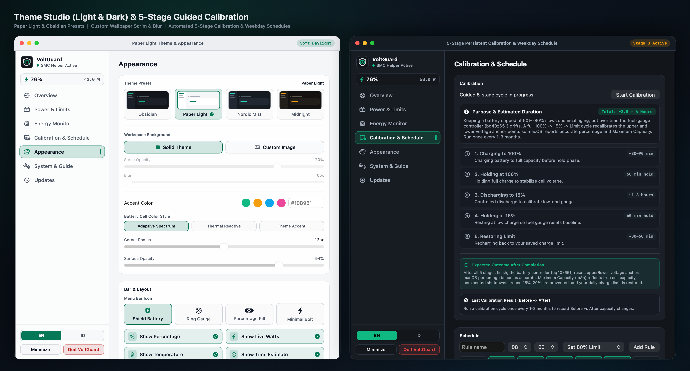

# VoltGuard

**VoltGuard** adalah aplikasi menu bar macOS untuk menjaga kesehatan dan memperpanjang masa pakai baterai MacBook Anda. Atur batas maksimal pengisian daya, lindungi baterai dari suhu panas, pantau aliran daya secara langsung, dan jalankan kalibrasi baterai otomatis langsung dari menu bar maupun jendela aplikasi penuh.

---

## Fitur Utama

### 1. Pembatas Pengisian Baterai & Bypass Charging Otomatis
- **Batas Pengisian Kustom (`20%` hingga `100%`)**: Mencegah baterai MacBook terus tertahan di `100%` saat sering terhubung ke charger.
- **Bypass Charging Otomatis di Batas Target**: Begitu baterai mencapai batas pengisian yang Anda pilih (misalnya `80%`), VoltGuard otomatis beralih ke **Bypass Charging**. Seluruh daya yang dibutuhkan MacBook langsung diambil 100% dari adaptor daya, sementara aliran listrik ke baterai diputus (`0.0 W`) sehingga baterai beristirahat tanpa panas dan tanpa siklus pakai.
- **Tombol Cepat & Kontrol Geser**: Pilih batas cepat (`60%`, `80%`, `90%`, `100%`) lewat satu klik, geser slider, atau tarik langsung garis batas pada ilustrasi baterai.
- **Top Up 100%**: Isi penuh baterai ke `100%` satu kali sebelum bepergian. Setelah mencapai `100%`, VoltGuard otomatis mengembalikan batas pengisian harian Anda.

### 2. Perlindungan Baterai Cerdas
- **Pelindung Panas (Heat Protection)**: Menjeda pengisian daya secara otomatis ketika suhu baterai melewati batas aman yang Anda tentukan, lalu melanjutkan pengisian setelah suhu baterai kembali dingin.
- **Mode Sailing**: Membiarkan persentase baterai turun beberapa persen secara alami sebelum mulai mengisi ulang lagi, sehingga baterai tidak terus-menerus mengalami pengisian pendek di angka batas.
- **Pengosongan Baterai (Discharge)**: Gunakan daya baterai meskipun kabel charger tetap terpasang, baik secara manual maupun otomatis ketika baterai melebihi batas yang ditentukan (termasuk opsi saat layar MacBook tertutup).
- **Kontrol Lampu MagSafe & Mode Hemat Daya**: Atur warna lampu indikator MagSafe mengikuti status pengisian, cegah pengisian saat MacBook tidur (sleep), dan aktifkan Mode Hemat Daya otomatis saat menggunakan baterai.

### 3. Rekomendasi Profil Pemakaian
- **4 Profil Siap Pakai**:
  - **Travel**: Batas `100%` dengan penghemat daya saat menggunakan baterai untuk perjalanan jauh.
  - **Balanced**: Batas `80%` dengan perlindungan panas harian untuk pemakaian campuran.
  - **Desk Docked**: Batas `75%` untuk MacBook yang hampir selalu terhubung ke charger di meja kerja.
  - **Max Lifespan**: Batas `60%` dengan perlindungan suhu ekstra ketat untuk usia baterai paling awet.
- **Profil Kustom**: Simpan kombinasi batas pengisian, jarak Mode Sailing, dan batas suhu favorit Anda sendiri.

### 4. Aliran Daya Langsung & Estimasi Waktu
- **Visualisasi Aliran Daya (Live Power Flow)**: Lihat berapa Watt daya yang masuk dari adaptor, berapa yang dipakai oleh MacBook, dan berapa yang masuk atau keluar dari baterai secara real-time.
- **Estimasi Waktu Stabil**: Menampilkan sisa waktu pemakaian baterai sampai habis, atau estimasi waktu sampai baterai mencapai target batas pengisian Anda.
- **Monitor Energi Aplikasi**: Menampilkan daftar aplikasi yang sedang memakan daya paling besar beserta tombol cepat untuk menutup aplikasi tersebut.

### 5. Kesehatan Baterai & Riwayat Harian
- **Ringkasan Kondisi Baterai**: Menampilkan persentase Kesehatan Baterai (Maximum Capacity), jumlah siklus pengisian (Cycle Count), kapasitas saat ini dibandingkan kapasitas bawaan pabrik, serta status kondisi baterai (`Normal`, `Menurun`, atau `Perlu Servis`).
- **Grafik Tren Kesehatan**: Mencatat riwayat kesehatan dan suhu puncak baterai setiap hari secara otomatis serta mendukung salin data ke format CSV.

### 6. Kalibrasi Baterai 5-Tahap & Jadwal Otomatis
- **Tujuan Kalibrasi**: Saat baterai terus dibatasi pada `60%` hingga `80%`, pembacaan persentase baterai di macOS lama-kelamaan bisa kurang akurat. Kalibrasi penuh membantu menyelaraskan kembali pembacaan titik penuh dan titik rendah baterai. Cukup dijalankan **1 hingga 3 bulan sekali**.
- **Estimasi Durasi**: Total sekitar **`3,5 hingga 6 jam`** (berjalan otomatis dari awal sampai selesai dan tetap tersimpan meskipun aplikasi ditutup sementara):

| Tahap | Nama Tahap | Estimasi Waktu | Penjelasan |
| :--- | :--- | :--- | :--- |
| **1** | **Mengisi ke 100%** | `~30 - 90 menit` | Mengisi baterai sampai benar-benar penuh `100%`. |
| **2** | **Menahan di 100%** | **`60 menit`** | Menahan baterai di posisi `100%` agar pembacaan kapasitas penuh stabil. |
| **3** | **Mengosongkan ke 15%** | `~1 - 3 jam` | Menguras baterai secara terkontrol hingga `15%` tanpa perlu mencabut charger. |
| **4** | **Menahan di 15%** | **`60 menit`** | Mengistirahatkan baterai di `15%` tanpa pengisian agar pembacaan batas bawah akurat. |
| **5** | **Memulihkan Batas** | `~30 - 60 menit` | Mengisi kembali baterai ke batas harian Anda (misalnya `80%`) lalu kembali ke perlindungan normal. |

- **Jadwal Otomatis (Schedule)**: Buat jadwal harian atau mingguan untuk mengatur batas `80%`, menyalakan `Top Up 100%`, atau menjalankan pengosongan baterai pada jam yang Anda inginkan.

### 7. Kustomisasi Tampilan, Gambar Latar, & Bahasa
- **4 Tema Warna**: Pilih tema `Obsidian`, `Paper Light`, `Nordic Mist`, atau `Midnight`, lengkap dengan pilihan warna aksen, kelengkungan sudut, dan transparansi kartu.
- **Gambar Latar Kustom (Custom Background)**: Pasang gambar atau wallpaper favorit Anda sebagai latar jendela aplikasi dan popover menu bar, lengkap dengan pengatur tingkat gelap latar (**Scrim Opacity**) dan tingkat buram (**Blur**).
- **Kustomisasi Menu Bar & Popover**: Pilih dari 4 gaya ikon menu bar (`Shield Battery`, `Ring Gauge`, `Percentage Pill`, `Minimal Bolt`), tampilkan persentase, daya Watt, suhu, atau sisa waktu di menu bar, serta atur urutan kartu di dalam popover.
- **Dua Bahasa**: Beralih antara **Bahasa Indonesia (`ID`)** dan **English (`EN`)** kapan saja dengan satu klik.

---

## Kompatibilitas MacBook, Chip & Versi macOS

VoltGuard dirancang sebagai **Universal Binary** (`arm64` + `x86_64`) dengan target minimum **macOS 14.0 Sonoma**.

### Dukungan Berdasarkan Versi macOS & Firmware
| Versi macOS | Arsitektur / Chip | Mekanisme SMC | Status Dukungan | Catatan |
| :--- | :--- | :--- | :--- | :--- |
| **macOS 14 Sonoma** | Apple Silicon M1/M2/M3 & Intel | `CH0B`/`CH0C`/`CH0I` (`BCLM`/`CH0K` Intel) | **Didukung Penuh** | Kontrol pengisian & discharge penuh lewat key SMC standar |
| **macOS 15 Sequoia (< 15.8)** | Apple Silicon M1–M4 & Intel | `CH0B`/`CH0C`/`CH0I` (`BCLM`/`CH0K` Intel) | **Didukung Penuh** | Kontrol pengisian & discharge penuh + Bypass Charging murni |
| **macOS 15.8 / 26 Tahoe** | Apple Silicon M1–M4 / M5 & Intel | `CHTE` + `CHIE` / `bfF0` | **Didukung Penuh** | Mendukung kunci Tahoe (`CHTE`) & cut adapter (`CHIE`) |
| **macOS 27 Beta 1–3 (`20356`–`20457.0.77`)** | Apple Silicon | `bfF0`/`bfD0`/`bfE0` + `CHIE` | **Didukung Penuh** | Mode Firmware Limit bawaan SMC |
| **macOS 27 Beta 4+ / 27.x (`20457.0.125.0.2+`, termasuk 27.2.1)** | Apple Silicon M4 / M5 | **Adapter Mode (`CHIE=0x08`)** | **Didukung (Adapter Mode)** | Apple mengunci `CH0B`/`CH0C`/`CHTE`/`bfF0` (`kIOReturnNotPrivileged`). VoltGuard otomatis memakai Adapter Mode (`CHIE`) saat Mac terjaga dengan band hysteresis 3% agar baterai tidak penuh ke 100% |
| **macOS 11–13 (Big Sur, Monterey, Ventura)** | Apple Silicon / Intel | - | **Tidak Didukung** | Aplikasi membutuhkan SwiftUI macOS 14.0+ |

### Dukungan Per-Fitur Berdasarkan Perangkat
| Fitur VoltGuard | Apple Silicon (macOS 14–26) | Apple Silicon (macOS 27.x Adapter Mode) | Intel MacBook (2016–2020, macOS 14+) |
| :--- | :---: | :---: | :---: |
| **Charge Limit (`20%–100%`)** | ✅ Bypass Charging | ✅ Adapter-Cut Hysteresis (`CHIE`) | ✅ `BCLM` / `CH0B` |
| **Mode Sailing & Pelindung Panas** | ✅ | ✅ | ✅ |
| **Discharge Manual & Otomatis** | ✅ (`CH0I` / `CHIE`) | ✅ (`CHIE=0x08`) | ✅ (`CH0I` / `CH0K`) |
| **Kalibrasi Baterai 5-Tahap** | ✅ | ✅ (saat Mac terjaga) | ✅ |
| **Kontrol Lampu MagSafe 3 LED** | ✅ (`ACLC`) | ✅ (`ACLC`) | ⚠️ Tidak ada MagSafe 3 |
| **Aliran Daya, ETA, Health & Energy Monitor** | ✅ (`IOKit`) | ✅ (`IOKit`) | ✅ (`IOKit`) |
| **Crash & Signal Guard + Diagnostik Mandiri** | ✅ | ✅ | ✅ |

> **Catatan macOS 27.x**: Pada **Adapter Mode (`CHIE`)**, memutus adaptor saat tutup layar tertutup (*Clamshell Mode*) dapat membuat macOS tertidur kecuali opsi cegah tidur diaktifkan. Selain itu, setiap pembaruan app tetap memerlukan satu kali klik **Perbarui Helper** di menu bar / Sistem & Panduan jika versi daemon root lama masih aktif.

---

## Cara Menggunakan

1. Buka **VoltGuard** dari ikon di menu bar kanan atas atau tekan pintasan keyboard `Cmd+Option+V`.
2. Pertama kali digunakan, buka menu **Sistem & Panduan** lalu klik **Pasang Helper SMC** satu kali agar VoltGuard dapat mengatur batas pengisian baterai MacBook Anda.
3. Pilih **Batas Pengisian** harian (disarankan `80%` untuk pemakaian sehari-hari atau `60%--75%` jika selalu terhubung ke charger).
4. Nyalakan **Pelindung Panas** dan **Mode Sailing** untuk perlindungan otomatis setiap hari.
5. Gunakan tombol **Top Up 100%** kapan pun Anda membutuhkan baterai penuh sebelum bepergian.
