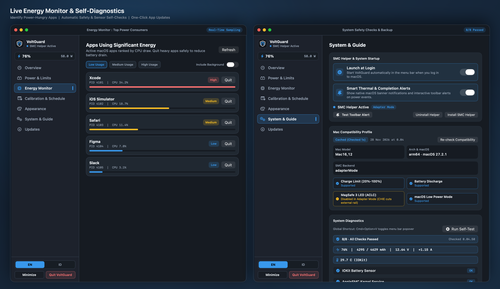

# VoltGuard

[](https://github.com/zixew/voltguard/actions/workflows/macos-ci.yml)

-10B981)


> **English Summary:** **VoltGuard** is a native SwiftUI macOS menu bar app that protects MacBook battery health by limiting max charge (`20%` to `100%`), monitoring real-time power flow, preventing thermal stress, and automating 5-stage calibration. It supports Apple Silicon (`M1` through `M5`) and Intel Macs (2016-2020 official, 2012-2015 via OCLP) on **macOS 13 Ventura through macOS 27** (including automatic `CHIE` Adapter Mode when macOS 27 locks legacy charge-control keys).

**VoltGuard** adalah aplikasi menu bar macOS untuk menjaga kesehatan dan memperpanjang usia baterai MacBook Anda. Atur batas pengisian harian, cegah panas berlebih saat bekerja dengan charger terpasang, pantau aliran daya secara langsung, dan jalankan kalibrasi baterai otomatis langsung dari menu bar maupun jendela dashboard penuh.

---

## Preview Aplikasi




---

## Daftar Isi
- [Mulai Cepat (Quick Start)](#mulai-cepat-quick-start)
- [Mengapa Perlu Membatasi Pengisian Baterai?](#mengapa-perlu-membatasi-pengisian-baterai)
- [Fitur Utama](#fitur-utama)
- [Kompatibilitas MacBook, Chip & Versi macOS](#kompatibilitas-macbook-chip--versi-macos)
- [Kalibrasi Baterai 5-Tahap](#kalibrasi-baterai-5-tahap)
- [FAQ & Troubleshooting](#faq--troubleshooting)
- [Build dari Source](#build-dari-source)
- [Pendamping iPhone (VoltGuard iOS)](#pendamping-iphone-voltguard-ios)

---

## Mulai Cepat (Quick Start)

1. **Pasang Aplikasi**: Unduh `VoltGuard.dmg`, lalu seret `VoltGuard.app` ke folder **Applications**.
2. **Buka dari Menu Bar**: Klik ikon perisai VoltGuard di kanan atas menu bar, atau tekan pintasan **`Cmd + Option + V`**.
3. **Pasang Helper SMC (1 Kali Saja)**:
   - Buka **Open App -> Sistem & Panduan**, lalu klik **Pasang Helper SMC** (masukkan password admin Mac).
   - Ini memberi izin sistem agar VoltGuard bisa membaca dan mengatur kontrol pengisian daya pada chip SMC MacBook Anda.
4. **Pilih Batas Harian**: Pilih preset **80%** untuk pemakaian normal, atau **60% - 75%** jika MacBook hampir selalu tercolok charger di meja kerja.

---

## Mengapa Perlu Membatasi Pengisian Baterai?

Menahan baterai Lithium-ion di angka `100%` terus-menerus sambil terkena panas adaptor mempercepat penurunan kapasitas (*chemical aging*). VoltGuard menjaga baterai tetap berada di zona nyaman (`60%` sampai `80%`) tanpa perlu repot mencabut-pasang kabel charger, dan tetap menyediakan tombol **Top Up 100%** satu kali setiap kali Anda hendak bepergian jauh.

---

## Fitur Utama

### 1. Batas Pengisian Daya (`20%` hingga `100%`)
- **Preset & Kontrol Fleksibel**: Pilih cepat `60%`, `80%`, `90%`, atau `100%`, geser slider, atau tarik garis batas langsung pada ilustrasi baterai.
- **Bypass Charging Otomatis (macOS 14 - 26)**: Saat mencapai target batas (misal `80%`), arus ke baterai dihentikan dan laptop ditenagai langsung dari adaptor daya.
- **Mode Adapter Otomatis (`CHIE`, macOS 27+)**: Pada firmware macOS 27 terbaru di mana Apple mengunci kunci charge-inhibit internal, VoltGuard otomatis beralih memutus adaptor (`CHIE=0x08`) di batas atas dan menyambungkannya lagi setelah turun `3%` sehingga baterai tetap tidak penuh ke `100%`.
- **Top Up 100%**: Isi penuh satu kali sebelum bepergian; begitu mencapai `100%`, batas harian otomatis kembali aktif.

### 2. Perlindungan Cerdas & Kontrol Daya
- **Mode Sailing**: Memberi jeda alami beberapa persen di bawah target batas sebelum mengisi kembali, mencegah pengisian pendek (*micro-cycles*) berulang.
- **Pelindung Panas (Heat Protection)**: Menjeda pengisian otomatis jika suhu baterai melebihi batas aman (default `35°C`), lalu lanjut saat suhu kembali dingin.
- **Discharge Manual & Otomatis**: Gunakan daya baterai meski kabel charger terpasang untuk menurunkan persentase atau kalibrasi (mendukung opsi Clamshell saat layar tertutup).
- **Lampu MagSafe 3 LED & Mode Tidur**: Sinkronkan warna LED MagSafe (`Amber` saat mengisi, `Hijau` saat batas tercapai), cegah pengisian saat Mac tertidur, dan aktifkan Mode Hemat Daya otomatis saat memakai baterai.

### 3. Aliran Daya Real-Time, Estimasi Waktu & Monitor Energi
- **Aliran Daya (Power Flow)**: Lihat daya adaptor masuk, konsumsi sistem MacBook, dan arus bersih baterai secara langsung (`Watt`, `Volt`, `Ampere`, suhu).
- **Estimasi Waktu Stabil**: Menghitung perkiraan waktu menuju batas pengisian atau waktu habis baterai tanpa lonjakan angka tiap detik.
- **Monitor Energi Aplikasi**: Menemukan aplikasi paling boros CPU/baterai dan menyediakan tombol tutup cepat.

### 4. Kustomisasi, Jadwal Otomatis, & Keandalan Sistem
- **4 Tema + Wallpaper Kustom**: `Obsidian`, `Paper Light`, `Nordic Mist`, dan `Midnight`, lengkap dengan warna aksen, transparansi, blur, dan background gambar pilihan Anda.
- **Uji Mandiri Interaktif (Self-Diagnostic) & Crash Guard**: Memeriksa status sensor `IOKit`, driver `AppleSMC`, koneksi Helper, versi binary, proteksi crash/sinyal POSIX, dan menyimpan riwayat kesehatan baterai harian (`CSV Export`).
- **Jadwal Otomatis & Dwi Bahasa**: Buat jadwal mingguan (`Set 80%`, `Top Up 100%`, `Discharge`) serta ganti bahasa **Bahasa Indonesia (`ID`)** atau **English (`EN`)** kapan saja.

---

## Kompatibilitas MacBook, Chip & Versi macOS

VoltGuard dikemas sebagai **Universal Binary (`arm64` + `x86_64`)** dengan syarat minimum **macOS 13.0 Ventura** serta deteksi otomatis seri Mac (`Apple Silicon`, `Intel T2`, `Intel Pre-T2`, maupun `Desktop Mac`).

### Dukungan Berdasarkan Versi macOS & Firmware

| Versi macOS | Arsitektur / Chip | Mekanisme SMC | Status | Catatan |
| :--- | :--- | :--- | :---: | :--- |
| **macOS 13 Ventura** | Apple Silicon M1-M2 & Intel (2017-2020) | `CH0B`/`CH0C`/`CH0I` (`BCLM`) | Didukung Penuh | Membuka dukungan resmi Intel 2017 tanpa patch; animasi ringkas untuk SwiftUI 13 |
| **macOS 14 Sonoma** | Apple Silicon M1-M3 & Intel | `CH0B`/`CH0C`/`CH0I` (`BCLM`/`CH0K`) | Didukung Penuh | Bypass charging, Sailing step-down, dan discharge penuh lewat SMC standar |
| **macOS 15 Sequoia (< 15.8)** | Apple Silicon M1-M4 & Intel | `CH0B`/`CH0C`/`CH0I` (`BCLM`/`CH0K`) | Didukung Penuh | Bypass charging penuh + MagSafe 3 LED |
| **macOS 15.8 & macOS 26 Tahoe** | Apple Silicon M1-M5 & Intel | `CHTE` + `CHIE` / `bfF0` | Didukung Penuh | Prioritaskan kunci Tahoe (`CHTE`) dengan fallback otomatis bila key lama terkunci |
| **macOS 27 Beta 1-3 (`20356` - `20457.0.77`)** | Apple Silicon | `bfF0`/`bfD0`/`bfE0` + `CHIE` | Didukung Penuh | Menggunakan mode Firmware Limit bawaan |
| **macOS 27 Beta 4+ / 27.x (`20457.0.125+`, termasuk 27.2.1)** | Apple Silicon M4 / M5 | **Adapter Mode (`CHIE=0x08`)** | Didukung (Adapter Mode) | Apple mengunci `CH0B`/`CH0C`/`CHTE`/`bfF0` (`kIOReturnNotPrivileged`). VoltGuard otomatis memakai `CHIE` dengan step-down Sailing & hysteresis 3% saat Mac terjaga |
| **macOS 11-12 (Big Sur - Monterey)** | Apple Silicon / Intel | - | Tidak Didukung | Membutuhkan `MenuBarExtra` & `AppIntents` macOS 13.0+ |

### Dukungan Berdasarkan Seri Mac

| Seri / Model Mac | Charge Limit | Bypass / Adapter Hold | Discharge & Kalibrasi | MagSafe 3 LED (`ACLC`) | Low Power Mode | Catatan |
| :--- | :---: | :---: | :---: | :---: | :---: | :--- |
| **MacBook Pro 14"/16" (M1 Pro/Max, M2, M3, M4, M5)** | Ya | Ya | Ya | **Ya** (`ACLC`) | Ya | Semua fitur 100% didukung |
| **MacBook Air 13"/15" (M2, M3, M4, M5)** | Ya | Ya | Ya | **Ya** (`ACLC`) | Ya | Semua fitur 100% didukung |
| **MacBook Air M1 (2020) & MacBook Pro 13" M1/M2** | Ya | Ya | Ya | Tidak (USB-C only) | Ya | Kontrol MagSafe LED otomatis disembunyikan |
| **Intel MacBook Pro / Air 2018-2020 (Chip T2)** | Ya | Ya (`CH0B`) | Ya (`CH0I`/`CH0J`) | Tidak (USB-C only) | Ya | Memakai `CH0B`/`CH0C`/`CH0I`; tanpa LED MagSafe 3 |
| **Intel MacBook / Pro 2016-2017 (Non-T2)** | Ya (`BCLM`) | Ya (`BCLM`) | Ya (`CH0I`) | Tidak (USB-C only) | macOS 13+ | Resmi didukung di macOS 13 Ventura (& 14-15 via OCLP) |
| **Intel MacBook Pro / Air 2012-2015 (MagSafe 2)** | Ya (`BCLM`) | Via `BCLM` | Terbatas (`CH0I`) | Tidak (MagSafe 2) | Tidak | Didukung bila menjalankan macOS 13+ via OCLP |
| **Desktop Mac (`iMac`, `Mac mini`, `Mac Studio`, `Mac Pro`)** | Tidak | Tidak | Tidak | Tidak | Tidak | Otomatis menampilkan status *Desktop Mac Tanpa Baterai*; Monitor Energi tetap aktif |

---

## Kalibrasi Baterai 5-Tahap

Saat pengisian sering dibatasi di `60%-80%`, pembacaan persentase baterai di macOS bisa bergeser seiring waktu. Jalankan kalibrasi **1 sampai 3 bulan sekali** (total estimasi **`3,5 - 6 jam`**, progres tersimpan otomatis meski aplikasi sempat ditutup):

| Tahap | Nama Tahap | Estimasi Waktu | Fungsi |
| :---: | :--- | :--- | :--- |
| **1** | **Mengisi ke 100%** | `30 - 90 menit` | Mengisi baterai sampai benar-benar penuh `100%`. |
| **2** | **Menahan di 100%** | `60 menit` | Menstabilkan pembacaan kapasitas maksimal baterai. |
| **3** | **Mengosongkan ke 15%** | `1 - 3 jam` | Mengosongkan daya terkontrol sampai `15%` tanpa mencabut charger. |
| **4** | **Menahan di 15%** | `60 menit` | Mengistirahatkan sel agar titik batas bawah baterai terkalibrasi. |
| **5** | **Memulihkan Batas** | `30 - 60 menit` | Mengisi kembali ke target harian Anda (misal `80%`) lalu kembali ke mode normal. |

---

## FAQ & Troubleshooting

- **Kenapa baterai masih mengisi ke 100% setelah update aplikasi?**
  Pastikan daemon root di `/Library/PrivilegedHelperTools/com.voltguard.helper` sudah ikut diperbarui. Jika terlihat banner kuning **"Perbarui Helper / Update Helper"** di popover atau menu Sistem & Panduan, klik sekali dan masukkan password admin Mac.
- **Apa bedanya Bypass Charging (macOS 14-26) dengan Mode Adapter (`CHIE`, macOS 27+)?**
  Pada macOS 14-26, Apple masih mengizinkan pemutusan arus khusus ke sel baterai sambil tetap menyalakan Mac lewat adaptor. Pada macOS 27.x terbaru, Apple membatasi kunci tersebut ke entitlement internal sistem, sehingga VoltGuard otomatis beralih memutus input adaptor lewat `CHIE=0x08` antara batas atas dan batas bawah (default turun `3%`, atau sesuai Mode Sailing).
- **Apakah aman jika MacBook ditutup (Clamshell Mode) di macOS 27?**
  Di macOS 27 Adapter Mode, memutus adaptor saat tutup layar tertutup dapat membuat macOS tertidur kecuali opsi cegah tidur / *Discharge in Clamshell* diatur sesuai kebutuhan.
- **Bagaimana cara mengembalikan pengaturan charger ke standar pabrik Apple?**
  Cukup pilih **Quit VoltGuard** dari popover atau klik **Hapus Helper** di menu **Sistem & Panduan**. Saat keluar, VoltGuard otomatis mengembalikan pengisian ke default sistem (`100%`, `CHIE=0x00`).

---

## Build dari Source

Persyaratan: macOS 13.0+ dan Xcode Command Line Tools (`Swift 5.9+`).

```bash
git clone https://github.com/zixew/voltguard.git
cd voltguard

# Jalankan unit test & audit memory leaks
bash scripts/check_leaks.sh

# Build Universal Binary (.app + VoltGuard.dmg)
bash scripts/package_dmg.sh
```

---

## Pendamping iPhone (VoltGuard iOS)

Tersedia juga proyek pendamping versi iPhone di repositori terpisah (`VoltGuard-iOS`) untuk memantau telemetri Mac lewat jaringan lokal (LAN) dan memantau baterai iPhone secara native dengan SwiftUI.
