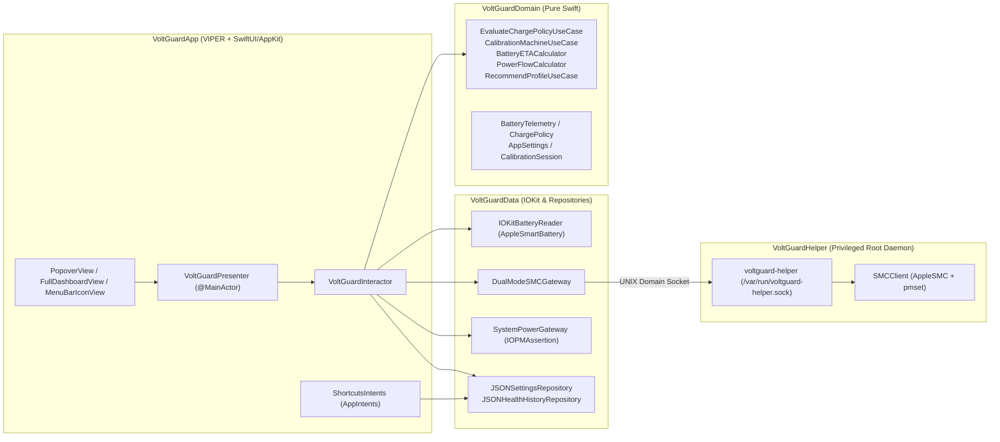

# VoltGuard

[](https://github.com/zixew/voltguard/actions/workflows/macos-ci.yml)

Native macOS 14+ menu bar battery and power management utility built with Swift 5.9, SwiftUI, AppKit, IOKit, and AppleSMC. Structured around Clean Architecture, VIPER presentation, and unidirectional state flow.


---

## Core Capabilities

### 1. Charge Control & Protection
- **Charge Limiter**: Set a custom charge cap between `20%` and `100%`, with one-click presets (`60%`, `80%`, `90%`, `100%`) and direct drag-to-adjust on the battery cell gate line.
- **Manual & Automatic Discharge**: Force battery discharge while plugged into AC power, or automatically discharge when charge exceeds `limit + 2%`.
- **Clamshell Discharge**: Optional permission to discharge while the MacBook lid is closed.
- **Heat Protection**: Pause charging when battery temperature crosses a configurable ceiling (`28 C` to `45 C`, default `35 C`) with a `2 C` hysteresis band to avoid rapid toggling.
- **Sailing Mode**: Let battery charge drift down by a configurable delta (`2%` to `20%`, default `5%`) before resuming charge, reducing micro-cycle wear.
- **Top Up 100%**: Charge to `100%` once before travel and automatically restore your saved charge limit once full.
- **Sleep & Low Power Control**: Prevent system sleep during active discharge or calibration, inhibit charging while sleeping, and toggle macOS Low Power Mode on battery or always.
- **MagSafe LED Control**: Switch LED behavior between `System`, `Off`, `Green`, `Amber`, or `Sync with Limit`.

### 2. Persistent 5-Stage Battery Calibration
- Guided cycle (`1. Charge to 100%` -> `2. Hold at 100%` -> `3. Discharge to 15%` -> `4. Hold at 15%` -> `5. Restore Limit`) with animated progress steps, hold countdown timer, and disk persistence across app restarts.
- Prerequisite checks warn if the power adapter is unplugged or if the SMC Helper is not yet installed.

### 3. Stabilized Time-Aware ETA & Live Power Flow
- **Time-Aware EMA Estimator**: Calculates time until empty and time to target charge limit using a 60-second time-aware exponential moving average (`alpha = 1 - exp(-dt / 60)`), `AppleRawCurrentCapacity` coulomb readings, initial `AvgTimeToEmpty` seeding, and upward hysteresis rate limiting (`±1 min` per step).
- **2-Segment Power Flow Conduit**: Live `Adapter Input (W)`, `System Load (W)`, `Battery Net (W)`, `Voltage (V)`, and `Current (A)` with an animated two-segment conduit (`Adapter -> System` and `System <-> Battery`) whose particle speed scales with wattage and pauses at `0.0%` CPU when the popover and dashboard window are closed.

### 4. Detailed Battery Diagnostics & Health History
- Reads Apple Silicon nested `BatteryData` (`NominalChargeCapacity`, `AppleRawMaxCapacity`, `AppleRawCurrentCapacity`, `DesignCapacity`, `CycleCount`, `DesignCycleCount9C`, `DeviceName`) to report accurate macOS-matched Maximum Capacity (`%`), capacity wear (`mAh`), and condition (`Normal`, `Fair`, `Service Recommended`).
- Records daily health snapshots (`health_history.json`), renders a 30-day health trend chart, and exports CSV to clipboard.

### 5. Theme Engine, Custom Background & Localization
- **4 WCAG AA Theme Presets**: `Obsidian`, `Paper Light`, `Nordic Mist`, and `Midnight` with mini-window preview swatch cards.
- **Custom Image Background**: Switch between `Solid Theme` and `Custom Image` (`NSOpenPanel` with downsampled `1920px` `CGImageSource` caching), complete with live `Scrim Opacity` (`0%` to `90%`) and `Blur` (`0px` to `24px`) sliders applied across the main window and menu bar popover.
- **Customizable Menu Bar & Popover**: 4 visual menu bar icon styles (`Shield Battery`, `Ring Gauge`, `Percentage Pill`, `Minimal Bolt`), optional `%`, `W`, `C`, and `ETA` badges, right-click quick action menu, module reordering/hiding, `Detailed` vs `Compact` density, and instant **English (`EN`) / Bahasa Indonesia (`ID`)** switching.
- **Apple Shortcuts (`AppIntents`) & Global Hotkey**: `Cmd+Option+V` global popover toggle, plus Shortcuts intents (`Set Charge Limit`, `Toggle Discharge`, `Top Up 100%`, `Get Battery Telemetry`) with live `DistributedNotificationCenter` settings reload.

---

## Architecture



### Hardware AppleSMC Keys (`voltguard-helper`)

| Key / Tool | Purpose | Values Written |
| :--- | :--- | :--- |
| `BCLM` | Charge limit percentage cap | `20` to `100` (`UInt8`) |
| `CHTE` | Charge inhibit / termination control | `[0x01, 0x00, 0x00, 0x00]` (inhibit) / `[0x00, ...]` (allow) |
| `CH0B` / `CH0C` | Charger inhibit bytes | `0x02` (inhibit) / `0x00` (allow) |
| `CH0I` | Force discharge on AC power | `0x01` (discharge) / `0x00` (normal) |
| `ACLC` | MagSafe LED override | `0x00` (system), `0x01` (off), `0x03` (green), `0x04` (amber) |
| `/usr/bin/pmset` | macOS Low Power Mode | `pmset -a lowpowermode 1` or `0` |

> [!NOTE]
> Without the privileged helper installed, VoltGuard runs in **Read-Only** mode: all IOKit battery telemetry, power flow topology, ETA calculation, health history, and profile recommendations remain active without requiring administrator privileges.

---

## Build, Test & Package

### Prerequisites
- macOS 14.0 (Sonoma) or newer
- Swift 5.9+ / Xcode 15.3+

### Commands

```bash
# Run all unit tests (26 tests)
swift test

# Build release binaries (VoltGuard + voltguard-helper)
swift build -c release

# Package VoltGuard.app and dist/VoltGuard.dmg (and install to /Applications locally)
bash scripts/package_dmg.sh

# Package DMG in CI mode (skips /Applications and iCloud Drive copy)
CI=true bash scripts/package_dmg.sh
```

---

## Panduan Singkat (Bahasa Indonesia)

1. Buka **VoltGuard** dari menu bar kanan atas atau tekan pintasan global `Cmd+Option+V`.
2. Atur **Batas Pengisian** (misal `80%`) lewat slider, tombol preset (`60% / 80% / 90% / 100%`), atau geser langsung garis batas pada sel baterai.
3. Pantau **Sisa Waktu** (`sampai habis` saat memakai baterai, atau `sampai penuh X%` sesuai batas pengisian saat di-charge) serta detail kapasitas `mAh` dan kondisi baterai di kartu **Kesehatan Baterai**.
4. Aktifkan **Pelindung Panas** dan **Mode Sailing** di tab `Daya & Batas` untuk menjaga umur sel baterai saat laptop sering terhubung ke adaptor.
5. Gunakan **Tampilan & Tema** untuk mengganti preset tema (`Obsidian`, `Terang`, `Nordic Mist`, `Midnight`), memasang **Gambar Kustom** beserta pengatur `Opasitas Scrim` dan `Blur`, atau memilih gaya ikon menu bar.
6. Buka **Sistem & Panduan -> Pasang Helper SMC** satu kali (membutuhkan izin administrator macOS) untuk mengaktifkan kontrol tulis perangkat keras `AppleSMC`.
